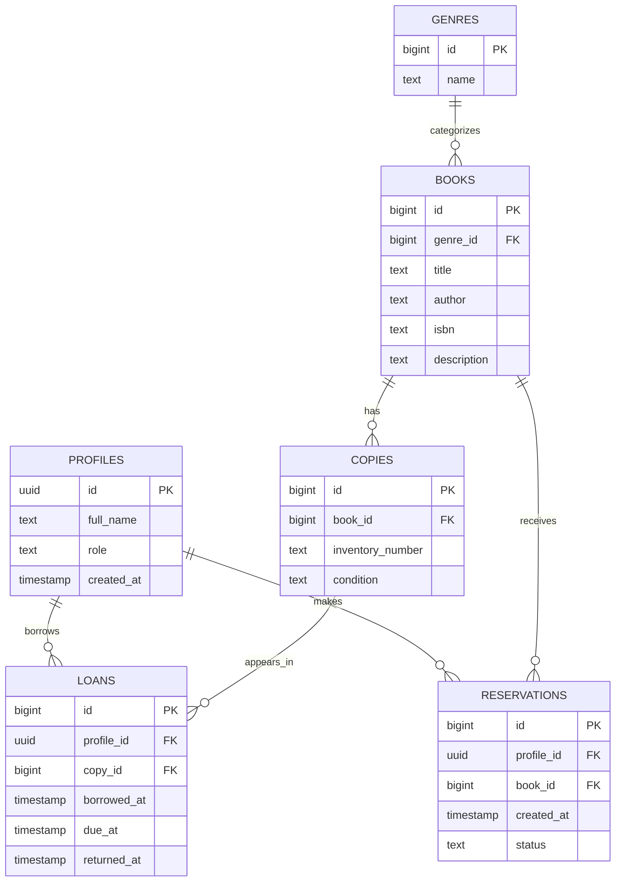

# BookConnect — ER диаграма

## Връзки

- Един жанр има много книги; всяка книга има един жанр.
- Една книга има много физически екземпляри.
- Един потребител може да има много заемания и резервации.
- Един екземпляр може да има много заемания във времето, но само едно активно заемане.
- Една книга може да има много резервации.

## Правила

- `profiles.id` съответства на потребителя в Supabase Auth.
- `role` е `student`, `teacher` или `librarian`.
- `returned_at = NULL` означава активно заемане.
- При реализацията ще се добави уникален частичен индекс върху `loans(copy_id)` за редовете с `returned_at IS NULL`, за да се предотврати двойно заемане.
- За достъпа ще се използват Supabase RLS политики.

*Това е начална схема, не доказателство за вече създадена база в Supabase.*
