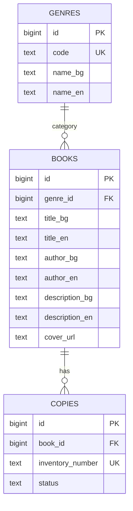

# ER — реално създадена база за Етап 2

Този файл документира **реалните** 3 таблици, проверени в Supabase. Първоначалният проектен модел от Етап 1 остава в `ER_DIAGRAM.md`.

- **PK:** първични ключове `id` в трите таблици.
- **FK:** `books.genre_id → genres.id`, `copies.book_id → books.id`.
- **UNIQUE:** `genres.code`, `copies.inventory_number`.
- **CHECK:** `copies.status` е `available`, `borrowed` или `reserved`.
- **Тестови записи при настройката:** 4 жанра, 6 книги, 11 екземпляра.
- **Достъп:** RLS включен; публично четене, но не и анонимно писане. Записът за библиотекар е ограничен чрез проверка на `auth.jwt().app_metadata.role` и RPC `add_book_with_copy` (виж `STAGE_2_MIGRATION.sql`).
- Таблиците `profiles`, `loans`, `reservations` от общия проектен план **не са реализирани** в Етап 2.
