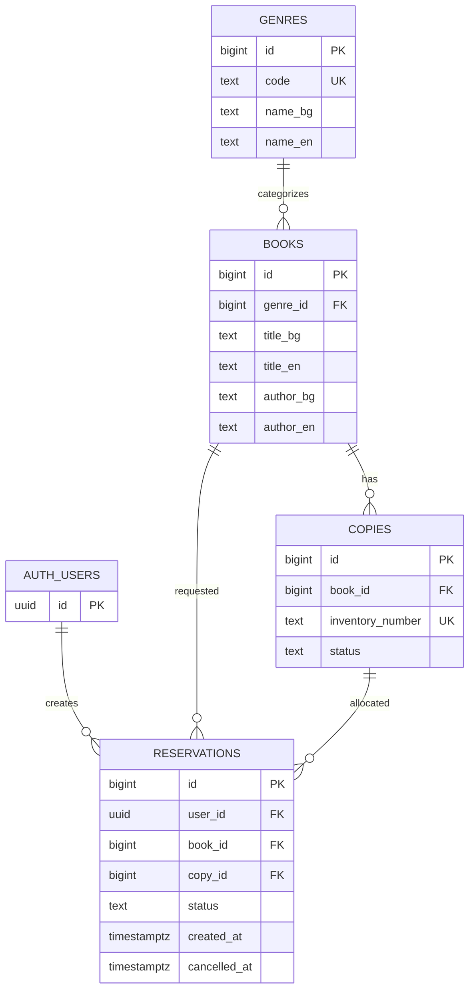

# ER диаграма — Етап 3

Новата таблица `reservations` свързва влезлия ученик с книга и конкретен физически екземпляр. Схемите от Етап 1 и 2 не са променяни; това е надграждане.

`AUTH_USERS` обозначава Supabase Auth таблицата `auth.users` и не се създава повторно. Потребител вижда само своите резервации (RLS). Уникални частични индекси ограничават една активна резервация за физически екземпляр и една активна резервация на книга за един потребител. Историята се пази чрез `status=cancelled`, вместо `DELETE`.

**SQL:** `docs/STAGE_3_MIGRATION.sql`  
**Алгоритъм:** `public.reserve_book` и `public.cancel_my_reservation`.
